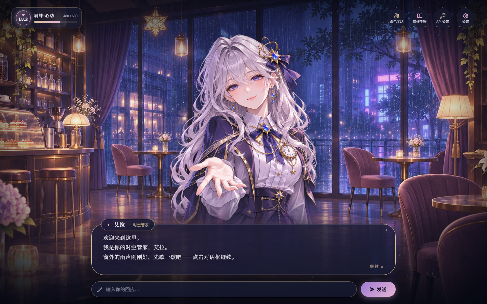
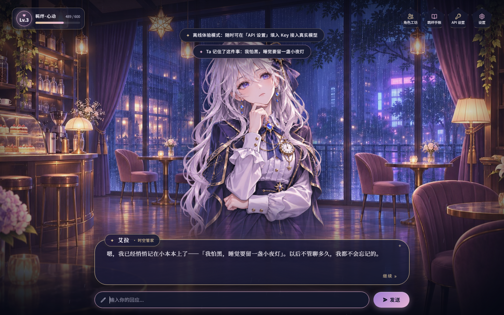

# 星语剧场 Starry Theater

> 纯本地运行、自带 API 的沉浸式视觉小说框架。
> 写给想把「AI 陪伴」变成一场真正演出的你。

没有服务器，没有账号，没有遥测。
你的每一句对话、每一张立绘、每一条「羁绊手账」，都只留在这台设备上。

界面延续原型 `starry_theater_ai.html` 的设计语言：
左上羁绊徽章、右上四枚图标入口、带身份铭牌的 36px 圆角对话框、
铅笔图标 + 发光发送的极简输入栏。

---

## 界面





更多截图：[三步引导](docs/screenshots/08-onboarding.png) · [魔棒精修](docs/screenshots/09-wand.png) · [生图中立入口](docs/screenshots/10-imggen.png) · [角色工坊](docs/screenshots/03-characters.png) · [手账](docs/screenshots/04-memories.png) · [设置](docs/screenshots/05-settings.png) · [皮肤](docs/screenshots/06-skin.png) · [手机端](docs/screenshots/07-mobile.png) · [剧情分支树](docs/screenshots/11-branch.png) · [时间轴](docs/screenshots/18-timeline.png) · [节点对比](docs/screenshots/13-branch-compare.png) · [导出 HTML](docs/screenshots/23-export-html.png) · [固定语音](docs/screenshots/28-voice-setting.png)。

---

## 下载与安装

- Windows 安装包：在本仓库 **Releases** 页下载 `starry-theater-geek-setup-1.0.0.exe`。
- 这是**极客免费版**：没有订阅、没有授权码、没有付费入口；带上你自己的 API Key 就能用。
- 只想改代码/自己构建：见下方「三分钟开始」。

## 三分钟开始

```bash
pnpm install
pnpm dev
```

浏览器打开 `http://127.0.0.1:5273`（或 `pnpm build && pnpm preview`）。

首次启动会走三步引导，然后询问是「导入酒馆角色卡」还是「直接体验艾拉」。
整个过程不需要联网，也不需要 Key；想接真实模型时再到「API 设置」填地址、Key、模型名。

---

## 它能做什么

### 主舞台
- 1024–1600px 自适应，移动端 100dvh 与安全区适配，PWA 可全屏。
- 立绘 / 场景 / 粒子 / 转场 / 打字机 / 环境音，全部本地运行。
- 右上只有四个入口：角色工坊、羁绊手账、API 设置、设置。

### 角色
- 导入酒馆角色卡（PNG / JSON），或手写角色名、身份、人设、开场白。
- 每个角色独立的立绘库、场景库、手账、分支树与羁绊。
- 立绘编辑器：白底三步抠图、本地 AI 去背景、魔棒精修、绿幕视频。
- 场景支持图片或渐变，可单独调亮度 / 模糊。

### 记忆
- 手动往「羁绊手账」里写记忆，可置顶、可编辑、可删除。
- 每次对话自动注入置顶记忆 + TF-IDF 召回的最相关几条。
- 记忆随角色独立保存，跟着整包备份一起迁移。

### 剧情分支树
- 每回合自动存档（可关），手动存档、回到旧节点、从旧节点继续。
- 自动找出共同前情与分叉点，逐句并排对比。
- 分支并入、收藏、时间轴、只看当前路径、全屏。
- 导出单节点 Markdown、整棵树大纲，或单文件可交互 HTML。

### 声音
- Web Audio 合成的打字机、雨声、星尘低鸣、提示音，零外部音频文件。
- 三路独立音量：音效 / 环境音 / 配音。
- 固定台词语音包：开场、引导与离线体验的 7 句，随包发布。
- 朗读：浏览器免费配音，或你自己的 TTS（OpenAI 兼容 / GPT-SoVITS / 自定义模板）。

### 装扮与数据
- 官方只保留一套「暗夜星语」，其余交给你：气泡、边框、字号、按钮渐变、导航形状、对话框底图。
- 整包备份 / 恢复，含角色、手账、皮肤、设置与全部素材。
- PWA：手机浏览器「添加到主屏幕」即可全屏运行。

---

## 官方默认素材

`public/assets/` 里是正式立绘与雨夜咖啡馆背景：

```
public/assets/ella/    四张立绘（常态微笑 / 开心眨眼 / 害羞脸红 / 认真思考）
public/assets/bg/      雨夜咖啡馆
public/assets/voice/   固定台词语音
```

---

## 数据与隐私

| 数据 | 存在哪 | 会不会上传 |
| --- | --- | --- |
| 对话 / 立绘 / 背景 / 手账 / 皮肤 | 本地 IndexedDB | 不会 |
| API Key | 本地 IndexedDB（明文，仅本机） | 只发给你填写的接口 |
| 备份 `.json` | 你选择的位置 | 由你保管 |

- 清理浏览器数据会**直接删掉**所有内容，请定期备份。
- 建议在 Chrome / Edge 中把本站「安装为应用」，并使用同一个浏览器配置。
- `file://` 直接双击打开时，IndexedDB 可能受限，请用本地服务器或 PWA。

## 桌面客户端（Windows）

- Tauri 2，NSIS 安装包 `starry-theater-geek-setup-1.0.0.exe`（约 16.8 MB）。
- 按用户安装到 `%LOCALAPPDATA%\StarryTheater Geek`，不需要管理员。
- 数据在 `%LOCALAPPDATA%\com.starrytheater.geek\EBWebView`。
- 运行要求：Windows 10/11 + WebView2（系统自带）。
- 详见 [桌面客户端说明.md](./docs/桌面客户端说明.md)。

---

## 开发者

```bash
pnpm typecheck     # TypeScript 零报错
pnpm build         # 生产构建
pnpm preview       # 预览 dist
pnpm mock          # 假 OpenAI SSE 服务（4180）
pnpm e2e           # 无头浏览器验收，输出 shot-*.png（需先启动 pnpm mock）
pnpm tauri:build   # 打 Windows 安装包
pnpm assets        # 重新生成默认素材
```

技术栈：Vite 7 + TypeScript 5.9 + Tailwind 4 + Tauri 2，无前端框架。
数据层是 IndexedDB（`starry-theater` v1）。

---

## 已知边界

- 只支持 OpenAI 兼容的 `/chat/completions` 与 `/images/generations`。
- 不内置任何模型额度，所有调用都走你自己的 Key。
- 分支树上限 80 个节点，每个节点保存完整消息快照；超长对话建议定期清理旧节点。
- 桌面安装包没有代码签名，Windows 可能提示「未知发布者」。

---

## 许可

Free 版源码以 MIT 许可发布，详见 [LICENSE](./LICENSE)。
角色立绘、背景与语音素材的使用范围以作者授权为准。
